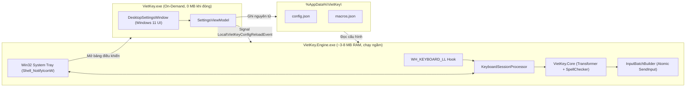

<p align="center">
  
</p>

# VietKey — Bộ gõ Tiếng Việt Native cho Windows 11

[](https://dotnet.microsoft.com/)
[](https://www.microsoft.com/windows)
[](https://github.com/CodeGenLabs/vietkey/releases/tag/v1.0.0)
[](#kiểm-thử-tự-động)
[](#kiến-trúc-2-tiến-trình-dual-process)

**VietKey** là bộ gõ Tiếng Việt hiện đại dành cho **Windows 11**, được thiết kế xoay quanh 3 tiêu chí cốt lõi:

1. **Siêu nhẹ & Tiết kiệm RAM (~3–8 MB khi chạy nền):** Tách biệt hoàn toàn tiến trình bắt phím nền (`VietKey.Engine.exe`) khỏi giao diện cài đặt (`VietKey.exe`). Khi đóng cửa sổ cài đặt, tiến trình UI thoát hoàn toàn và trả lại **100% RAM giao diện (0 MB XAML/GUI chạy ngầm)**.
2. **Gõ mượt, không độ trễ (Zero-Lag `< 1 ms`):** Bơm toàn bộ chuỗi xóa lùi (`VK_BACK`) và ký tự Unicode (`KEYEVENTF_UNICODE`) trong **một lệnh `SendInput` nguyên tử duy nhất**, kết hợp cơ chế chống nuốt chữ gợi ý tự động trên **Chrome, Edge, Google Search, VS Code, Microsoft Word và Microsoft Teams**.
3. **Kiến trúc đơn giản, 100% Offline:** Không phụ thuộc server, cơ sở dữ liệu hay dịch vụ đám mây. Toàn bộ cấu hình và từ điển gõ tắt được lưu dưới dạng JSON thuần tại `%AppData%\VietKey\`.

---

## Tính năng nổi bật

- **Hỗ trợ đầy đủ Telex & VNI (Bảng mã Unicode dựng sẵn NFC):**
  - **Telex:** `s` (sắc), `f` (huyền), `r` (hỏi), `x` (ngã), `j` (nặng), `z` (xóa dấu thanh), `aa/ee/oo` (`â/ê/ô`), `w` (`ă/ơ/ư`), `dd` (`đ`).
  - **VNI:** `1` (sắc), `2` (huyền), `3` (hỏi), `4` (ngã), `5` (nặng), `0` (xóa dấu thanh), `6` (`â/ê/ô`), `7` (`ơ/ư`), `8` (`ă`), `9` (`đ`).
- **Bỏ dấu tự do & Tự động dịch chuyển vị trí dấu thanh:**
  - Cho phép gõ dấu ở bất kỳ vị trí nào sau nguyên âm (`toanf` hoặc `toafn` → `toàn`, `duongwdf` → `đường`).
  - Tự động cân bằng cụm nguyên âm `ươ` (`thuowr` → `thuở`, thêm `n` + `g` → `thưởng`) và dịch dấu khi thêm nguyên âm/phụ âm cuối (`tuyet` + `s` + `e` → `tuyết`).
- **Tùy chọn chuẩn đặt dấu Hiện đại hoặc Cổ điển:**
  - **Kiểu mới (Hiện đại):** `hoà`, `khoẻ`, `thuý`.
  - **Kiểu cũ (Cổ điển):** `hòa`, `khỏe`, `thúy`.
- **Hoàn tác dấu thông minh khi gõ lặp phím (Double-Key Undo):**
  - Nhấn lặp phím dấu để hoàn tác về ký tự gốc và gõ tiếp từ tiếng Anh mượt mà:
    - `t` + `e` + `s` (`té`) + `s` → `tes` + `t` → **`test`**
    - `g` + `o` + `o` (`gô`) + `o` → `goo` + `d` → **`good`**
    - `t` + `o` + `w` (`tơ`) + `w` → `tow` + `n` → **`town`**
    - `d` + `d` (`đ`) + `d` → `dd` + `r` → **`ddr`**
- **Kiểm tra chính tả âm tiết Tiếng Việt & Tự khôi phục từ Tiếng Anh:**
  - Tự động kiểm tra cấu trúc âm tiết tiếng Việt (phụ âm đầu, cụm nguyên âm, phụ âm cuối, quy tắc thanh Sắc/Nặng với phụ âm tắc `c/ch/p/t`) để tự động trả về chuỗi phím tiếng Anh gốc (`window`, `function`, `restore`, `words`, `with`, `string`).
  - **Bảo toàn từ viết tắt tiếng Việt thông dụng bắt đầu bằng `đ`:** Gõ `ddc` hoặc `dcd` giữ nguyên **`đc`**, cùng các từ viết tắt `đk`, `đt`, `đh`, `đv`, `đn`, `đ`... mà không bị hoàn tác nhầm.
- **Tương thích bộ gõ ngoại ngữ (Nhật / Trung / Hàn - CJK IME):**
  - Tự động nhường quyền khi người dùng đang gõ Hiragana (`あ`), Katakana (`カ`/`ｶ`) hoặc Full-width Alphanumeric (`Ａ`), nhưng vẫn cho phép gõ Tiếng Việt bình thường khi đang để chế độ **Half-width Alphanumeric (`A`)**.
- **Sửa lỗi gợi ý tự động (Inline Autocomplete) trên trình duyệt Chromium:**
  - Triệt tiêu hiện tượng mất ký tự đầu khi gõ trên thanh địa chỉ Chrome, Edge, Brave, Firefox và ô tìm kiếm Google Search bằng kỹ thuật chèn ký tự trung gian `U+200C` (`ZeroWidthNonJoiner`) + `VK_BACK` trong cùng một gói `SendInput`.
- **Smart Switch (Nhớ trạng thái Anh/Việt theo từng ứng dụng):**
  - Tự động ghi nhớ và chuyển đổi chế độ **Tiếng Việt (`V`)** hoặc **Tiếng Anh (`E`)** khi bạn chuyển cửa sổ giữa các ứng dụng (ví dụ: đang gõ Tiếng Việt ở Word/Teams chuyển sang VS Code/Terminal sẽ tự chuyển về Tiếng Anh).
- **Bảng Gõ Tắt (Macros):**
  - Mở rộng từ viết tắt ngay khi nhấn phím Cách (`Space`) hoặc phím xuống dòng (`Enter`), ví dụ: `vn` → `Việt Nam`, `hcm` → `Thành phố Hồ Chí Minh`, `đc` → `được`.

---

## Kiến trúc 2 Tiến trình (Dual-Process)



| Thành phần | Vai trò | Mức tiêu thụ tài nguyên |
|---|---|---|
| **`VietKey.Core`** | Thư viện lõi xử lý âm tiết Tiếng Việt (Telex/VNI), kiểm tra chính tả, gõ tắt, bộ tạo gói `SendInput`, quản lý cấu hình JSON. | Thư viện thuần C#, nhúng trực tiếp vào file thực thi. |
| **`VietKey.Engine.exe`** | Tiến trình nền siêu nhẹ quản lý hook bàn phím `WH_KEYBOARD_LL`, vòng lặp thông điệp Win32 và biểu tượng khay hệ thống (`Shell_NotifyIconW`). | **~3–8 MB RAM**, `< 1 ms` mỗi phím nhấn. |
| **`VietKey.exe`** | Giao diện bảng điều khiển Windows 11 dạng Tab (chỉnh kiểu gõ, phím tắt, chính tả, Smart Switch, Macros, ô gõ thử nghiệm trực tiếp). | Chỉ khởi chạy khi mở cài đặt; **0 MB RAM** khi đóng cửa sổ. |

---

## Cấu trúc Thư mục

```text
vietkey/
├── VietKey.slnx                        # Solution chính cho Visual Studio / .NET CLI
├── src/
│   ├── VietKey.Core/                   # Lõi xử lý bộ gõ & cấu hình
│   │   ├── Config/                     # AppConfig, ConfigStore, ConfigReloadCoordinator
│   │   ├── Typing/                     # VietnameseTransformer, SyllableBuffer, VietnameseSpellChecker, MacroTable
│   │   └── Injection/                  # InputBatchBuilder, AppCompatibilityDetector, SmartSwitchTracker
│   ├── VietKey.Engine/                 # Tiến trình chạy ngầm (Win32 Hook + System Tray)
│   │   ├── Hook/                       # LowLevelKeyboardHook, KeyboardSessionProcessor
│   │   ├── Tray/                       # TrayIconHost, TrayIconRenderer, SingleInstanceGuard
│   │   └── Win32/                      # NativeMethods (P/Invoke user32, kernel32, shell32, imm32)
│   └── VietKey.UI/                     # Giao diện Bảng điều khiển Windows 11 (VietKey.exe)
│       ├── ViewModels/                 # SettingsViewModel
│       ├── MainWindow.xaml             # Giao diện cài đặt Fluent Windows 11 (4 Tab gọn nhẹ)
│       └── MainWindow.xaml.cs          # Xử lý sự kiện giao diện & ô gõ thử trực tiếp
├── tests/
│   └── VietKey.Core.Tests/             # 125 bài kiểm thử đơn vị & tích hợp (xUnit)
└── docs/
    └── system/                         # Tài liệu kiến trúc (ADR) & đặc tả hệ thống
```

---

## Hướng dẫn Cài đặt, Sử dụng & Đóng gói (Release)

### Tải bản phát hành sẵn (Khuyên dùng)
1. Tải file **[`VietKey_1.0.0.zip`](https://github.com/CodeGenLabs/vietkey/releases/latest)** từ trang **GitHub Releases**.
2. Giải nén sẽ được thư mục `VietKey` chỉ gồm đúng **2 file thực thi gọn nhẹ**:
   - **`VietKey.exe`**: Chạy file này để mở **Bảng điều khiển** (đồng thời tự động bật bộ gõ nền nếu chưa chạy).
   - **`VietKey.Engine.exe`**: Tiến trình bộ gõ chạy ngầm dưới khay hệ thống (System Tray).

### Yêu cầu hệ thống khi tự biên dịch
- **Hệ điều hành:** Windows 10 / Windows 11 (x64)
- **SDK / Runtime:** [.NET 8.0 Desktop Runtime / SDK](https://dotnet.microsoft.com/download/dotnet/8.0)
- **IDE (tùy chọn):** Visual Studio 2022 / 2026 (có cài workload *.NET desktop development*)

### Cách 1: Chạy trực tiếp trên Visual Studio hoặc .NET CLI

```powershell
# 1. Biên dịch toàn bộ solution ở chế độ Release
dotnet build VietKey.slnx -c Release

# 2. Mở Bảng điều khiển VietKey (tự động khởi chạy luôn bộ gõ nền VietKey.Engine)
dotnet run --project src/VietKey.UI/VietKey.UI.csproj -c Release

# 3. Hoặc chỉ chạy riêng tiến trình bộ gõ nền dưới System Tray
dotnet run --project src/VietKey.Engine/VietKey.Engine.csproj -c Release
```

### Cách 2: Đóng gói bản Release Single-File (Chỉ 2 file `.exe` + nén `.zip`)
Dự án hỗ trợ đóng gói **Single-File** nhúng toàn bộ thư viện `.dll`, cấu hình `.json` và tài nguyên `Assets` (icon, font `EVFont.ttf`) vào thẳng 2 file `.exe` duy nhất:

```powershell
# 1. Xóa thư mục publish cũ (nếu có)
Remove-Item -Path publish\VietKey -Recurse -Force -ErrorAction SilentlyContinue

# 2. Publish tiến trình nền VietKey.Engine.exe (Single-File)
dotnet publish src\VietKey.Engine\VietKey.Engine.csproj -c Release -r win-x64 --no-self-contained `
  -p:PublishSingleFile=true -p:DebugType=None -p:DebugSymbols=false -o publish\VietKey

# 3. Publish giao diện chính VietKey.exe vào cùng thư mục publish\VietKey (Single-File)
dotnet publish src\VietKey.UI\VietKey.UI.csproj -c Release -r win-x64 --no-self-contained `
  -p:PublishSingleFile=true -p:DebugType=None -p:DebugSymbols=false -p:DeleteExistingFiles=false -o publish\VietKey

# 4. Nén thành gói phân phối VietKey_1.0.0.zip (bên trong có thư mục VietKey chứa 2 file .exe)
Compress-Archive -Path publish\VietKey -DestinationPath publish\VietKey_1.0.0.zip -Force
```

Sau khi chạy xong:
- Thư mục `publish\VietKey\` chỉ chứa đúng 2 file: **`VietKey.exe`** và **`VietKey.Engine.exe`**.
- File nén `publish\VietKey_1.0.0.zip` chứa thư mục `VietKey/` bên ngoài và 2 file `.exe` bên trong, sẵn sàng để tải lên GitHub Releases.

---

## Bảng quy tắc gõ & Phím tắt

### 1. Phím tắt điều khiển nhanh
| Thao tác | Phím tắt / Cách dùng |
|---|---|
| Chuyển nhanh chế độ **Tiếng Việt (`V`) / Tiếng Anh (`E`)** | **`Ctrl + Shift`** hoặc **`Alt + Z`** (chỉnh trong Bảng điều khiển) |
| Đổi nhanh `V` / `E` bằng chuột | Click chuột trái vào biểu tượng **VietKey** dưới System Tray |
| Mở **Bảng điều khiển** | Chuột phải vào biểu tượng System Tray → *Bảng điều khiển VietKey...* hoặc mở `VietKey.exe` |

### 2. Bảng phím Telex & VNI
| Hiệu ứng | Kiểu gõ Telex | Kiểu gõ VNI | Ví dụ (Telex) |
|---|---|---|---|
| Dấu Sắc (`´`) | `s` | `1` | `as` → `á` |
| Dấu Huyền (`̀`) | `f` | `2` | `af` → `à` |
| Dấu Hỏi (`̉`) | `r` | `3` | `ar` → `ả` |
| Dấu Ngã (`~`) | `x` | `4` | `ax` → `ã` |
| Dấu Nặng (`.`) | `j` | `5` | `aj` → `ạ` |
| Xóa dấu thanh | `z` | `0` | `asz` → `a` |
| Đội mũ (`â`, `ê`, `ô`) | `aa`, `ee`, `oo` | `a6`, `e6`, `o6` | `tieengs` → `tiếng` |
| Dấu trăng (`ă`) | `aw` | `a8` | `awn` → `ăn` |
| Dấu móc (`ơ`, `ư`, `ươ`) | `ow`, `uw`, `uow` | `o7`, `u7`, `uo7` | `truowngf` → `trường` |
| Chữ Đ (`đ`, `Đ`) | `dd`, `DD` | `d9`, `D9` | `ddi` → `đi`, `ddc` → `đc` |
| Hoàn tác dấu về chữ thường | Gõ lặp lại phím dấu | Gõ lặp lại phím số | `tesst` → `test`, `goood` → `good` |

---

## Lưu trữ Cấu hình

Toàn bộ cấu hình được lưu trữ cục bộ, dễ dàng sao lưu hoặc chỉnh sửa trực tiếp tại `%AppData%\VietKey\`:
- **`%AppData%\VietKey\config.json`:** Lưu chế độ gõ, kiểu gõ (`Telex`/`VNI`), phím tắt, tùy chọn chính tả, Smart Switch, khởi động cùng Windows.
- **`%AppData%\VietKey\macros.json`:** Lưu danh sách các cặp từ gõ tắt (`{"vn": "Việt Nam", "đc": "được"}`).

Khi chỉnh sửa từ giao diện `VietKey.exe`, sự kiện hệ thống `Local\VietKeyConfigReloadEvent` sẽ thông báo cho `VietKey.Engine.exe` nạp lại cấu hình tức thời trong `< 50 ms` mà không cần khởi động lại bộ gõ.

---

## Kiểm thử Tự động

Dự án đi kèm bộ **125 bài kiểm thử đơn vị và tích hợp (xUnit)** kiểm chứng toàn diện bộ biến đổi Telex/VNI, đặt dấu Hiện đại/Cổ điển, hoàn tác phím đúp, kiểm tra chính tả tiếng Việt, gõ tắt, gói `SendInput` tương thích trình duyệt và đồng bộ cấu hình IPC:

```powershell
dotnet test VietKey.slnx
```

---

## Giấy phép (License)

Dự án được phát hành theo giấy phép **MIT License**.
