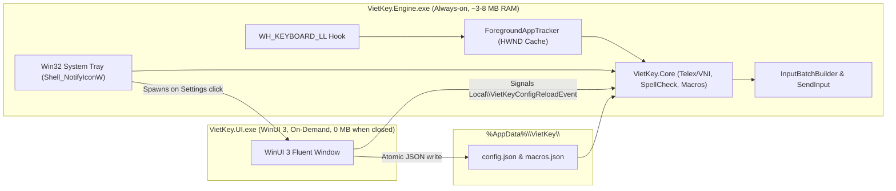

# Design — 0001-vietkey-mvp-winui3-ime

## Approach

We structure the solution (`VietKey.sln`) into three strict layers across four C# (.NET 8/9) projects: `VietKey.Core` (pure domain library), `VietKey.Engine` (headless Win32 hook + tray daemon), `VietKey.UI` (on-demand WinUI 3 Settings app), and `VietKey.Core.Tests` (xUnit test suite). `VietKey.Core` implements a zero-allocation-friendly syllable state machine (`SyllableBuffer`, `VietnameseTransformer`, `VietnameseSpellChecker`, `MacroTable`) that takes an input keystroke and returns an immutable `KeyTransformResult` (pass-through, or `BackspaceCount` + `ReplacementText` UTF-16 string). `VietKey.Engine` hosts a Win32 message loop (`GetMessageW`), registers `SetWindowsHookExW(WH_KEYBOARD_LL)`, maintains an O(1) `HWND -> AppProfile` cache updated on foreground changes, translates `KeyTransformResult` into a single `INPUT[]` array via `InputBatchBuilder` (adding the zero-width character autocomplete fix when targeting Chromium browsers), and renders the `Shell_NotifyIconW` tray icon. `VietKey.UI` provides a Windows 11 WinUI 3 settings window that edits `%AppData%\VietKey\config.json` and `macros.json`, signals `Local\VietKeyConfigReloadEvent`, and terminates on close (`ADR-0002`).

## Alternatives rejected

1. **Single-process WinUI 3 application minimized to System Tray:**
   - **Why it lost:** Even when a WinUI 3 `Window` is hidden (`AppWindow.Hide()`), the Windows App SDK runtime, DirectComposition visual tree, and D3D11/DXGI swapchain caches retain 40–70 MB of RAM. Splitting `VietKey.Engine` (pure Win32) and `VietKey.UI` (WinUI 3 on-demand) reduces idle RAM by ~90%.
2. **Per-keystroke sequential `SendInput` calls (`SendInput(Backspace)` then `Thread.Sleep(5)` then `SendInput(Char)`):**
   - **Why it lost:** Calling `SendInput` multiple times with sleeps inside or near `LowLevelKeyboardProc` introduces visible typing lag in VS Code/Monaco and Teams, and risks out-of-order key interleaving during fast typing (> 100 WPM). Packing all `VK_BACK` and `KEYEVENTF_UNICODE` packets into a single atomic `SendInput` call eliminates race conditions and sleeps.
3. **Text Services Framework (TSF `ITfTextInputProcessor`) COM DLL:**
   - **Why it lost:** TSF requires registering an in-proc COM server loaded into every target application process, complicating deployment, debugging, and 64-bit/ARM64 compatibility, violating the user's priority #3 ("Kiến trúc đơn giản, dễ bảo trì").
4. **Calling `Process.GetProcessById` on every keystroke to detect Chrome/VS Code/Word:**
   - **Why it lost:** Opening a process handle and querying its image name on every key press adds 0.3–1.5 ms of kernel overhead per keystroke. Caching the `AppCompatibilityProfile` and Smart Switch language state by `HWND` (and only querying `OpenProcess(PROCESS_QUERY_LIMITED_INFORMATION)` + `QueryFullProcessImageNameW` when `GetForegroundWindow()` changes) reduces hot-path cost to a pointer comparison (< 50 ns).

## Risks and early warning signals

1. **Risk: Chromium inline autocomplete eats the first character (`d` + `d` -> `dđ` instead of `đ`).**
   - **Early warning signal:** Typing `dd` or `aa` in Chrome's address bar or Google Search box when an autocomplete suggestion is highlighted leaves the base character intact.
   - **Mitigation:** `InputBatchBuilder` prepends `U+200B` (Zero-Width Space) key-down/key-up + 1 extra `VK_BACK` key-down/key-up before the `N` backspaces in the same `SendInput` batch when `AppCompatibilityProfile == ChromiumBrowser` and `BrowserAutocompleteFix == true`.
2. **Risk: Windows silently unhooks `WH_KEYBOARD_LL` if callback exceeds `LowLevelHooksTimeout` (default 300 ms).**
   - **Early warning signal:** Vietnamese typing stops working after a system freeze or heavy CPU load while the tray icon still shows `V`.
   - **Mitigation:** Keep `LowLevelKeyboardProc` strictly free of I/O, allocations, and locks; reload configuration on a background wait thread (`RegisterWaitForSingleObject` on `Local\VietKeyConfigReloadEvent`) and swap an immutable `AppConfig` reference via `Volatile.Write`.
3. **Risk: Elevated (Run as Administrator) target windows ignore `SendInput` from a normal-privilege `VietKey.Engine`.**
   - **Early warning signal:** Typing in an Administrator PowerShell or elevated VS Code window does not transform Vietnamese characters (Windows UIPI restriction).
   - **Mitigation:** Document UIPI behavior clearly and allow `VietKey.Engine` to run with matching integrity or optional elevation in settings.

## Claims changed

`forge impact --change 0001-vietkey-mvp-winui3-ime` reports `0` existing claims touched. This change introduces three candidate claims to be ratified after implementation:
- `ARC-dual-process-isolation` (anchored to `src/VietKey.Engine/Program.cs` and `src/VietKey.UI/App.xaml.cs`)
- `INV-hook-nonblocking` (anchored to `src/VietKey.Engine/Hook/LowLevelKeyboardHook.cs`)
- `INV-atomic-sendinput` (anchored to `src/VietKey.Core/Injection/InputBatchBuilder.cs`)
- Recorded architectural decision in `docs/system/decisions/ADR-0002-dual-process-hook-architecture.md`.
